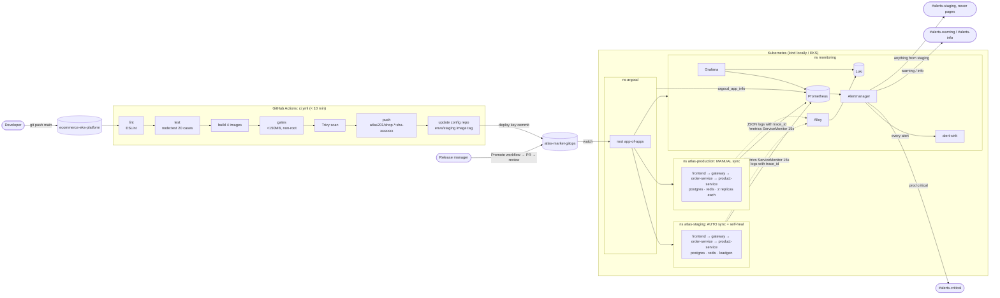

# Atlas Market: GitOps Platform with Monitoring

GitOps configuration repository for **Atlas Market**, a 4-service e-commerce application (Node.js + nginx, Postgres, Redis).
A commit to the app repo is tested, scanned and built by CI, written into this repo as a new image tag, deployed to **staging automatically** by ArgoCD, and promoted to **production by a reviewed PR plus a manual sync**. Prometheus, Loki, Grafana and Alertmanager watch every step. They are deployed by ArgoCD from this same repo.

| Repository | Role |
|---|---|
| [`ecommerce-eks-platform`](https://github.com/Jason2303/ecommerce-eks-platform) | Application code (frontend, gateway, product-service, order-service), Dockerfiles, CI pipeline, Terraform for EKS |
| **`atlas-market-gitops`** (this repo) | Desired state of every environment: Helm chart + per-env values, ArgoCD apps, monitoring stack, alerts, dashboards, runbooks |

---

## 1. Architecture



**Request path and trace propagation.** The gateway starts (or continues) a W3C `traceparent` trace and forwards it. order-service passes it on to product-service. Every log line written while handling the request carries the same `trace_id` (with a per-hop `span_id`), and the response returns it as `X-Trace-Id`. In Grafana, *Atlas / Logs → trace_id* shows one request's journey across all services.

---

## 2. Capstone checklist → evidence

| Requirement | Where |
|---|---|
| Pipeline runs on push to main | [`ci.yml`](https://github.com/Jason2303/ecommerce-eks-platform/blob/main/.github/workflows/ci.yml) `on: push: branches: [main]` |
| Stages lint, test, scan, build, push | jobs `lint-test` (ESLint `--max-warnings=0`, `node --test`) → `build` (build, size + non-root gates, Trivy, push) |
| Config repo updated with new tag | job `update-config` writes `envs/staging/values.yaml` with a repo-scoped deploy key |
| Pipeline < 10 min | Parallel matrices + GHA layer cache; every job has `timeout-minutes` (5/10/5) |
| ArgoCD manages **all** deployments | `argocd/root-app.yaml` (app-of-apps) → app **and** monitoring stack. Only secrets are created outside Git |
| Staging auto, production manual | `argocd/apps/atlas-market.yaml`: one ApplicationSet; `templatePatch` adds `automated` only for staging |
| Self-heal reverts manual changes | `./scripts/chaos.sh drift` (gateway scaled to 3 → back to 1) |
| Git revert rolls back | §5.6 |
| Prometheus scraping all targets | ServiceMonitors: app (`charts/atlas-market/templates/servicemonitor.yaml`), ArgoCD, Loki, Alloy + kube-prometheus-stack defaults |
| Grafana dashboards with real data | 4 dashboards in `platform/monitoring-config/dashboards/` (staging has continuous synthetic traffic) |
| Loki collecting logs from all pods | Alloy `loki.source.kubernetes` over every pod (`platform/monitoring/alloy.yaml`) |
| ≥ 5 alert rules | **14 alerts** + 4 recording rules, all unit-tested (`tests/alerts.test.yaml`) |
| Alerts route to appropriate channels | Severity- and environment-based routing, verified with `amtool` (§6) |
| 3+ services communicating | frontend → gateway → order-service → product-service (+ Postgres, Redis) |
| Health and metrics endpoints | `/healthz` (liveness), `/readyz` (dependencies), `/metrics` (Prometheus) on every Node service |
| Structured logging with trace_id | JSON logs; `trace_id` + `span_id` added via AsyncLocalStorage; unit-tested and verified end-to-end |
| Architecture diagram, deployment guide, runbooks, design decisions | §1, §5, [`runbooks/`](runbooks/), §7 |

---

## 3. Repository layout
```
argocd/
  root-app.yaml                 app-of-apps (the only Application applied by hand)
  projects.yaml                 AppProjects: platform (monitoring) / atlas (the app, locked down)
  rbac.yaml                     developer: sync staging only · release-manager: sync production
  apps/
    atlas-market.yaml           ApplicationSet -> atlas-staging (auto) + atlas-production (manual)
    monitoring-*.yaml           kube-prometheus-stack, loki, alloy (official charts + values from here)
    monitoring-config.yaml      our rules, dashboards, alert-sink
charts/atlas-market/            Helm chart (from the app repo) + ServiceMonitor, scrape NetworkPolicy, loadgen
envs/
  staging/values.yaml           image.tag written by CI · 1 replica · loadgen on
  production/values.yaml        image.tag written by promotion PR · 2 replicas · PDBs
platform/
  monitoring/                   Helm values: kube-prometheus-stack (incl. Alertmanager routing), loki, alloy
  monitoring-config/            alert-rules.yaml, argocd-servicemonitor.yaml, alert-sink.yaml, dashboards/
runbooks/                       one per alert
tests/alerts.test.yaml          promtool unit tests (11 scenarios)
scripts/                        bootstrap, chaos (demos), promote, test-alerts, build_dashboards
.github/workflows/              validate.yml (render, schema, policy, alert tests) · promote.yml (gated PR)
```

---

## 4. Observability

### Metrics (`/metrics`, prom-client)
| Metric | Service | Use |
|---|---|---|
| `http_requests_total{method,route,status}` | all 3 | Rate + errors (RED). `route` is the template (`/products/:id`), never the raw URL |
| `http_request_duration_seconds{method,route}` | all 3 | Duration (RED), p50/p95/p99 |
| `shop_orders_total{result=placed\|rejected\|invalid\|failed}` | order-service | Checkout outcomes (business) |
| `shop_revenue_cents_total`, `shop_order_value_cents` | order-service | Revenue, order value |
| `product_cache_requests_total{result=hit\|miss}` | product-service | Redis cache effectiveness |
| `product_stock_reservations_total{result}`, `product_stock_units{sku}` | product-service | Stock health (gauge read from Postgres at scrape time) |
| `gateway_rate_limited_requests_total`, `gateway_upstream_errors_total{target,kind}` | gateway | Protection and dependency failures |
| `process_*`, `nodejs_*` | all 3 | Runtime (CPU, heap, event-loop lag) |

### Logs
One JSON object per line: `{time, level, service, msg, trace_id, span_id, ...}`. Alloy turns `level` and `service` into Loki labels and keeps `trace_id` as **structured metadata** (high cardinality, so it is never a label).

### Dashboards (Grafana → folder *Atlas*)
| Dashboard | Content |
|---|---|
| **Atlas / Service overview (RED + business)** | Rate, 5xx ratio, p50/p95/p99 per service, route × status table, error log panel; orders/min, revenue/hour, checkout success, cache hit ratio, order value, stock levels |
| **Atlas / Infrastructure + GitOps** | Node CPU / memory / disk / network / I/O, Postgres + Redis availability, pods not ready, restarts, CPU/memory per namespace, **ArgoCD sync/health table** |
| **Atlas / Logs + trace lookup** | Error and warning counts, volume, top error messages, recent errors, **follow one trace_id across services**, **alert notifications delivered** |
| **Atlas / SLO 99.5%** | 30-day availability, error budget remaining, 1h/6h burn rates |

### Alerts (`platform/monitoring-config/alert-rules.yaml`)
| Alert | Condition | Severity | Runbook |
|---|---|---|---|
| HighErrorRate | 5xx > 5% for 5m | critical | [high-error-rate](runbooks/high-error-rate.md) |
| ServiceDown | scrape target down 2m | critical | [service-down](runbooks/service-down.md) |
| DatabaseDown | postgres 0 ready for 2m | critical | [database-down](runbooks/database-down.md) |
| NodeNotReady | node not Ready 5m | critical | [node-not-ready](runbooks/node-not-ready.md) |
| SLOErrorBudgetBurnFast | 14.4× burn (1h & 5m) | critical | [slo-burn-rate](runbooks/slo-burn-rate.md) |
| HighLatencyP99 | p99 > 1s for 5m | warning | [high-latency](runbooks/high-latency.md) |
| RedisDown | redis 0 available 5m | warning | [redis-down](runbooks/redis-down.md) |
| OrderFailuresHigh | > 5% of checkouts fail on our side, 10m | warning | [order-failures](runbooks/order-failures.md) |
| PodCrashLooping | > 3 restarts in 1h | warning | [pod-crashlooping](runbooks/pod-crashlooping.md) |
| DiskSpaceLow | < 10% free 5m | warning | [disk-space-low](runbooks/disk-space-low.md) |
| StagingOutOfSync | staging not Synced 15m | warning | [argocd-sync](runbooks/argocd-sync.md) |
| ArgoAppDegraded | app Degraded 10m | warning | [argocd-sync](runbooks/argocd-sync.md) |
| SLOErrorBudgetBurnSlow | 6× burn (6h & 30m) | warning | [slo-burn-rate](runbooks/slo-burn-rate.md) |
| LowStock | < 5 units for 10m | info | [low-stock](runbooks/low-stock.md) |

Each alert has a `severity` label, `summary` + `description` annotations, and a `runbook_url`.

---

## 5. Deployment guide

### 5.1 Prerequisites
Docker (6 GB+ RAM for Docker Desktop), `kind`, `kubectl`, `helm` 3, `yq` (mikefarah), `openssl`, `git`. On Windows, run the scripts in **Git Bash**.
A kind cluster (`kind create cluster --name argo-lab`), or EKS from the app repo's Terraform.

### 5.2 Create this repo and connect CI to it
1. Push this folder to `github.com/Jason2303/atlas-market-gitops` (**public**, so ArgoCD can read it without credentials).
2. Create a deploy key and give the **app repo** CI write access to **this repo only**:
   ```bash
   ssh-keygen -t ed25519 -N "" -f atlas-deploy-key -C atlas-ci-bot
   ```
   - This repo → Settings → Deploy keys → add `atlas-deploy-key.pub`, tick **Allow write access**.
   - App repo → Settings → Secrets and variables → Actions: secret `CONFIG_REPO_DEPLOY_KEY` = private key; variable `CONFIG_REPO` = `Jason2303/atlas-market-gitops`.
   - Delete the local key files.
3. Branch protection on `main`: PR + CODEOWNERS review required; add *Deploy keys* to the bypass list (CI commits staging bumps). Settings → Environments → `production` → required reviewers.

### 5.3 Bootstrap the cluster (once)
```bash
./scripts/bootstrap.sh                       # optional: SLACK_WEBHOOK_URL=https://hooks.slack.com/... ./scripts/bootstrap.sh
kubectl -n argocd get applications -w        # watch ArgoCD build everything
```
What gets created, in sync-wave order: kube-prometheus-stack → loki, alloy, monitoring-config → atlas-staging (synced automatically) and atlas-production (OutOfSync, waiting for a human).
Secrets (DB passwords, Grafana admin, Slack webhook) are generated by the script and never stored in Git.

### 5.4 First release
Push to `main` in the app repo. CI builds `sha-xxxxxxx` images and commits the tag to `envs/staging/values.yaml`. ArgoCD deploys staging within ~3 minutes (or click *Refresh*).
*If GitHub-hosted runners are unavailable*, the app repo's `scripts/local-ci.sh` runs the same stages locally and loads the images straight into kind.

### 5.5 Promote to production
1. **Actions → promote to production → Run** (blank = the staging tag). Approve the `production` environment gate. The workflow opens a PR. Alternatively: `./scripts/promote.sh`.
2. Review and merge the PR. `atlas-production` turns **OutOfSync**.
3. Log in to ArgoCD as **release-bob** → *atlas-production* → **App Diff** → **Sync**. (dev-alice gets *permission denied*.)

### 5.6 Roll back
```bash
git revert <commit that changed image.tag>    # e.g. the CI bump or the promotion merge
git push
```
Staging rolls back on its own; production shows OutOfSync and a release manager syncs it. ArgoCD's own *Rollback* button is disabled for auto-synced apps on purpose, because Git must stay the source of truth.

### 5.7 Demonstrations
```bash
./scripts/chaos.sh drift     # self-heal: kubectl scale staging gateway to 3 -> reverted to 1 in seconds
./scripts/chaos.sh outage    # prod Postgres stopped + traffic -> DatabaseDown, HighErrorRate fire
./scripts/chaos.sh status    # firing alerts + notifications received by alert-sink
./scripts/chaos.sh reset     # then Sync atlas-production (release-bob) to restore Postgres from Git
```

### 5.8 Access
| UI | Command | Login |
|---|---|---|
| ArgoCD | `kubectl -n argocd port-forward svc/argocd-server 8080:443` | admin / `argocd-initial-admin-secret` |
| Grafana | `kubectl -n monitoring port-forward svc/kps-grafana 3000:80` | admin / `grafana-admin` secret |
| Prometheus | `kubectl -n monitoring port-forward svc/kps-prometheus 9090` | (in-cluster only) |
| Alertmanager | `kubectl -n monitoring port-forward svc/kps-alertmanager 9093` | (in-cluster only) |
| Shop | `kubectl -n atlas-staging port-forward svc/frontend 8081:8080` | |

---

## 6. Alert routing
```
every alert ─┬─> alert-sink   (always: JSON audit line in Loki -> proof of delivery)
             ├─> namespace=atlas-staging -> #alerts-staging    (staging never pages)
             ├─> severity=critical       -> #alerts-critical   (10s group wait, 1h repeat; pager-ready)
             ├─> severity=warning        -> #alerts-warning
             └─> severity=info           -> #alerts-info       (24h repeat)
Inhibition: critical mutes the same warning · fast SLO burn mutes slow · DatabaseDown mutes its symptoms
```
Checked in CI with `amtool config routes test` (`scripts/test-alerts.sh`).

---

## 7. Design decisions

| Decision | Why | Trade-off |
|---|---|---|
| **Separate config repo** | Deploy history = `git log`; app commits don't trigger deploys of unrelated config; different reviewers for prod | Two repos to keep consistent; the chart is copied here from the app repo |
| **Image tag = `sha-<commit>`** | Immutable, traceable to the exact commit; `latest` is never deployed | Tags aren't human-friendly (use `v*` tags for releases) |
| **CI writes the tag (not ArgoCD Image Updater)** | Every deploy is an explicit, revertable commit by a known actor | Needs a deploy key |
| **Deploy key, not a PAT** | Write access to one repo only; revocable in one click | One key per repo |
| **ApplicationSet + `templatePatch`** | One definition for both envs; prod differs only in sync policy | Requires ArgoCD ≥ 2.10 |
| **App-of-apps incl. monitoring** | "ArgoCD manages everything": the platform is reproducible from Git, drift in the monitoring stack is also healed | First sync takes a few minutes (CRDs before ServiceMonitors: sync waves + `SkipDryRunOnMissingResource`) |
| **Two AppProjects** | The app project can only deploy this repo into its two namespaces, with no RBAC/quotas; only the platform project is cluster-wide | More RBAC to maintain |
| **Production = PR + manual sync** | Two human checkpoints (code review of the diff, and the live ArgoCD diff at sync time) | Slower releases (acceptable for production) |
| **Staging alerts never page** | Staging breaks on purpose sometimes; on-call trust depends on low noise | Staging problems are only seen in `#alerts-staging` |
| **alert-sink webhook** | Proves delivery and keeps an audit trail in Loki without depending on Slack | One extra tiny pod |
| **Trace context without a tracing backend** | `trace_id` correlation across services today, with zero new infrastructure; W3C format means Tempo/Jaeger can be added later without changing callers | No span timings/waterfall yet |
| **Business metrics in the services** | Revenue/orders/stock alert on what the business cares about, not just CPU | Small amount of app code |
| **`product_stock_units` read at scrape time** | Always matches the database; no extra writer | One cheap query per scrape per replica |
| **Loki single binary + filesystem** | Right-sized for a lab | Not HA; use object storage + simple-scalable mode on EKS |
| **Operator admission webhook off** | Its Helm-hook certificate jobs fight ArgoCD diffing | Rules are validated in CI (`promtool`) instead |
| **NetworkPolicies on for EKS, off on kind** | The chart's default-deny policies (+ new Prometheus-scrape allow) are proven on the VPC CNI; kind's policy support differs | Local runs are less isolated |

**Considered and rejected:** Argo Rollouts canaries (no traffic splitting in the lab; it's the next step), ArgoCD Image Updater (implicit deploys), a single repo with branches per env (merge-hell; "promotion" isn't a merge), Prometheus `remote_write` to a managed service (cost).

---

## 8. Security summary
- No secrets in Git: secrets are generated by `bootstrap.sh`, the Slack URL is mounted from a Secret (`api_url_file`), and CI uses `GITHUB_TOKEN` scopes plus a single-repo deploy key. `validate.yml` fails if a chart renders a plain `Secret`.
- ArgoCD RBAC deny-by-default: developers sync staging only, release managers sync production, Applications come from Git only.
- Workloads (unchanged from the app repo): non-root numeric UIDs, read-only root FS, all capabilities dropped, seccomp, Pod Security `restricted` on both app namespaces.
- Grafana: random admin password from a Secret, anonymous access and sign-up off. All UIs are ClusterIP and port-forward only.
- Supply chain: Trivy blocks fixable CRITICAL CVEs, there's an image size and non-root gate, and only immutable tags are deployed (enforced by `validate.yml` and `promote.yml`).

## 9. Screenshots
See [`docs/screenshots/`](docs/screenshots/).
